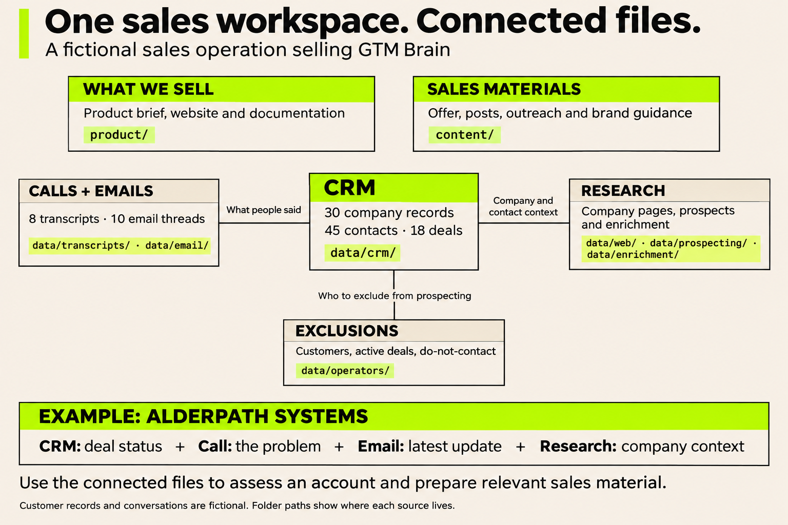

# GTM Brain sample sales data

A fictional sales operation selling GTM Brain setup, training and handover. The CRM, calls, emails and research refer to the same companies and people, so you can follow an account across sources.

**[Download the dataset as a ZIP](https://github.com/gtm-week/berlin-codex-dummy/archive/refs/heads/main.zip).** Unzip it and use the CSV and Markdown files directly. No installation or connectors are required.

## What's inside

| Folder | Contents | What it tells you |
|---|---|---|
| [product/](product/) | GTM Brain brief, website copy and documentation excerpt | What we sell, what it can do and its limits |
| [data/crm/](data/crm/) | 30 company records, 45 contacts, 18 deals and seller owners | Who we know, their roles, deal stages and next steps |
| [data/transcripts/](data/transcripts/) | 8 sales-call transcripts | Problems, objections, buying criteria and onboarding needs |
| [data/email/](data/email/) | 10 email threads | Introductions, follow-ups, stakeholder changes and timing updates |
| [data/web/](data/web/) | 12 fictional company-page extracts | What an account does, its team and hiring signals |
| [data/prospecting/](data/prospecting/) | The same 15 prospects before and after research | Missing information and what the research adds |
| [data/enrichment/](data/enrichment/) | 15 prepared results: 10 matched, 3 unmatched, 2 ambiguous | Contact matches and unresolved identities |
| [data/operators/](data/operators/) | 18 exclusion records | Existing customers, active opportunities and do-not-contact accounts |
| [content/](content/) | Sample offer, two posts, outreach example, voice guidance and brand assets | Material to adapt when drafting offers and content |

The 18 deals are split evenly: **New lead, Discovery, Evaluation, Proposal, Won and Lost**, with three in each stage. Accounts include SaaS teams, agencies and consultancies with different existing stacks.

## How the files connect

The company is the shared reference. Its contacts and deals point to its CRM record; calls, emails and company pages identify the same account. [source-index.csv](data/source-index.csv) lists each conversation or page, its date and the file that contains it.

**Example: Alderpath Systems**

| Source | What it adds |
|---|---|
| [Companies](data/crm/companies.csv), [contacts](data/crm/contacts.csv) and [deals](data/crm/deals.csv) | The account, people involved, proposal stage and next step |
| [Discovery call](data/transcripts/t01-alderpath.md) | Why the team needs help and what a useful pilot would do |
| [Email thread](data/email/e01-alderpath.md) | The follow-up and stakeholder involvement |
| [Company page](data/web/w01-alderpath.md) | What the company does |

Read these together to prepare an account brief or a relevant offer. Product documents explain what you can offer; the content folder supplies examples to adapt.

For joins, use `company_id` across tables and `contact_id` for people. Deals use `primary_contact_id`. The [schema](data/SCHEMA.md) explains the fields; the [source map](SOURCE-MAP.md) shows which tools the files stand in for.

## What to expect in the data

There are 30 company records representing **29 businesses**, including one intentional duplicate. Some budgets and buying-authority fields are empty because they are unknown. A contact's enthusiasm does not mean they can approve a purchase.

The files also include an older CRM note superseded by a later email, a stalled evaluation, a customer needing onboarding help, a lost deal with a stated reason and one incomplete transcript. Dates and missing information are part of the account history.

## What's real and what's fictional

Customer companies, people, conversations, activity and commercial terms are fictional. Addresses use `.example` domains. Do not send to or run live enrichment on them.

GTM Brain product context comes from the sources listed in [product/source-provenance.md](product/source-provenance.md). The sample EUR 2,400 service offer is fictional, not official product pricing. No customer results are claimed.

**Snapshot: 16 November 2026.** These are simple sample schemas, not native exports from the named tools.
